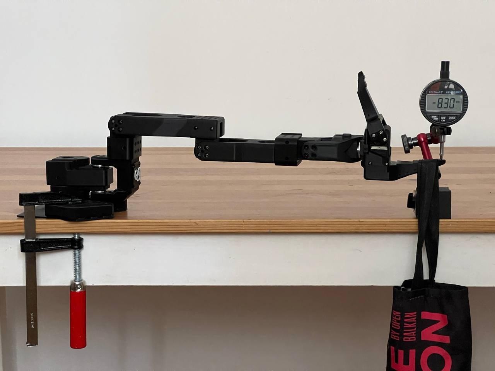
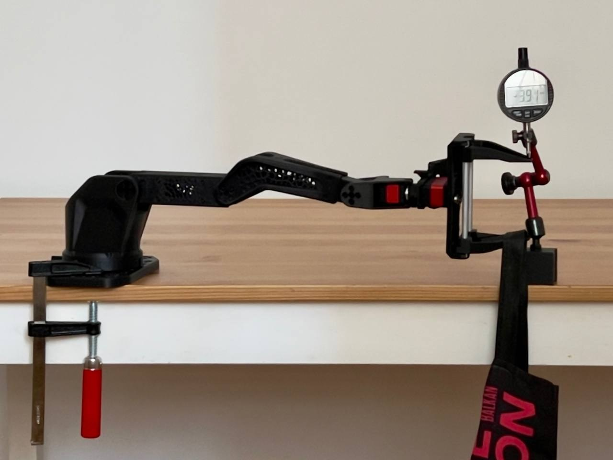

<!-- translation-navigation -->
[English](../../en/docs/specifications.md) · [Русский](../../ru/docs/specifications.md) · [Español](../../es/docs/specifications.md) · [Français](../../fr/docs/specifications.md) · [Deutsch](../../de/docs/specifications.md) · [Português (Brasil)](../../pt-BR/docs/specifications.md) · [简体中文](../../zh-CN/docs/specifications.md) · [日本語](../../ja/docs/specifications.md) · [हिन्दी](specifications.md) · [العربية](../../ar/docs/specifications.md)

[अंग्रेज़ी मूल](../../../specifications.md)

[दस्तावेज़](../README.md) · [प्रिंटिंग](printing.md) · [सामग्री सूची](bom.md) · [असेंबली](assembly-guide.md) · [विनिर्देश](specifications.md) · [मॉडल](../models/README.md) · [योगदान](../CONTRIBUTING.md) · [लाइसेंस](../LICENSING.md) · [अनुवाद](translations.md)

> यह दस्तावेज़ का पूर्ण अनुवाद है। चित्र और मूल PDF पुस्तिका सभी भाषाओं में साझा हैं। अनुवाद AI की सहायता से तैयार किया गया है; मूल भाषा बोलने वालों ने अभी इसकी समीक्षा नहीं की है।
<!-- /translation-navigation -->

<!-- translated-content -->

# विनिर्देश और परीक्षण परिणाम

मापा गया Robonine अगस्त और सितम्बर में प्रोटोटाइप 2026* गणना* चिह्नित संख्याएँ इस से आती हैं URDF मॉडल और सर्वोमोटर डाटाशीट, एक माप से नहीं.

## ज्यामिति

| जोड़ | सीमा |
|---|---|
| आधार का घुमाव | −176° … +176° (352°) |
| कंधा उठाना | −43° … +181° (224°) |
| कोहनी मोड़ना | −166° … +77° (243°) |
| कलाई मोड़ना | −85° … +111° (196°) |
| कलाई घुमाना | −165° … +163° (328°) |
| ग्रिपर | 0 … 85 mm |

| लिंक | अक्षों के बीच |
|---|---|
| आधार परिक्रमण कंधे पर | 85 mm |
| कंधे से कुल्हाड़ी | 119 mm |
| कुल्हाड़ी से कलाई फ्लेक्स | 139 mm |
| कलाई फ्लेक्स से कलाई रोल | 62 mm |
| ग्रिपर टिप पर कलाई रोल करें | 132 mm |

| पहुंच, ग्रिपर टिप केंद्र |  |
|---|---|
| क्षैतिज त्रिज्या | 483 mm |
| आधार तल से ऊपर की ऊंचाई | 544 mm तक |
| आधार तल के नीचे, रोबोट हाथ तालिका किनारे पर | −301 mm तक |

रिच 100,000 बेतरतीब पोज़ से संयुक्त सीमा के भीतर गणना की गई थी, बिना किसी स्व-टकराव के.

## सर्वो

| जोड़ | फ़ॉलोअर | लीडर |
|---|---|---|
| 1 आधार परिक्रमण | STS3235 | STS3215 |
| 2 कंधे उठाएँ | STS3250 | STS3215 |
| 3 कोहनी फ्लेक्स | STS3250 | STS3215 |
| 4 कलाई फ्लेक्स | STS3235 | STS3215 |
| 5 कलाई घुमाएं | ST-3215-C049, 1:191 | STS3215 |
| 6 ग्रिपर / ट्रिगर | ST-3215-C049, 1:191 | STS3215 |
| आपूर्ति | 12 V | 5 V |

## ग्रिपर

| | |
|---|---|
| प्रकार | समानांतर, रैक तथा पिनियन, दो चलने वाले दाँत |
| खुलने की चौड़ाई | 85 mm |
| बक्सा, अनुशंसित अधिकतम चौड़ाई | 75 mm के बारे में |
| बेलन, अनुशंसित अधिकतम व्यास | 70 mm के बारे में |
| गोलाकार, अनुशंसित अधिकतम व्यास | 60 mm के बारे में |
| कैमरा | ग्रिपर पर USB कैमरा माउन्ट करें |

## SO-ARM 101 के विरुद्ध मापे गए परिणाम

| मापदंड | SO-ARM 101 | SO-ARM 102 | बदलाव |
|---|---|---|---|
| ग्रिपर टिप पर विवर्तन, 300 g, रोबोट हाथ पूरी तरह से विस्तारित ¹ | 7.5 mm | 3.4 mm | −55 % |
| समान, सभी लिंक 100% भरें ¹ | — | 2.34 mm | −69 % |
| क्षैतिज त्रिज्या | 441 mm | 483 mm | +9.5 % |
| आधार के पीछे पहुँच | 377 mm | 473 mm | +25.5 % |
| आधार के घूमने की सीमा | 220° | 352° | +60 % |
| कोहनी की गति-सीमा | 194° | 243° | +25 % |
| कंधे और कुल्हाड़ी कोई लोड गति, * गणना * | 270 °/s | 450 °/s | +67 % |
| आधार के जोड़ का बैकलैश | 8.75 गिनती | 5.00 गिनती | −43 % |
| आधार बैकलैश से क्षैतिज टिप त्रुटि, * गणना* | ±2.96 mm | ±1.85 mm | −37.5 % |
| पुनरावृत्ति सटीकता | — | 0.1 mm के बारे में |  |
| 1 m पर शोर | 70 dB | 60 dB | −10 dB |
| रेटेड पेलोड | 150 g | 300 g |  |

 ¹ दोनों रोबोट हाथों को जोड़ों 2, 3 और 4 में प्रिंट किए गए सर्वोमोटर डमी के साथ बनाया गया था, इसलिए केवल फ्रेम की तुलना की गई है. SO-ARM 101 PLA में प्रिंट किया गया, SO-ARM 102 Fiberon PET-CF17 में 25% भरने पर. उसी SO-ARM 102 परीक्षण का दूसरा चलना 3.9 mm दिया।

| SO-ARM 101 | SO-ARM 102 |
|:-:|:-:|
|  |  |

## वर्तमान तथा तापमान, अनुगामी रोबोट हाथ

मापा गया 300 g पुनरावृत्ति पथ पर लोड करें, वातावरण 30 °Cछह STS3250 सर्वोमोटर.

| | |
|---|---|
| औसत धारा | 1.26 A |
| पीक धारा | 3.28 A |
| सर्वो का अधिकतम तापमान | 46 °C |

## निरपेक्ष सटीकता

समायोजन अभी जारी है। सर्वो की मूल PID सेटिंग के साथ, पूरी तरह फैलाए गए आर्म का सिरा उसके अपने वजन से लगभग 50 mm झुक गया। PID समायोजन के बाद यह लगभग 5 mm रह गया। सटीकता का एक अलग परीक्षण प्रोफ़ाइल तैयार किया जा रहा है।
<!-- /translated-content -->
