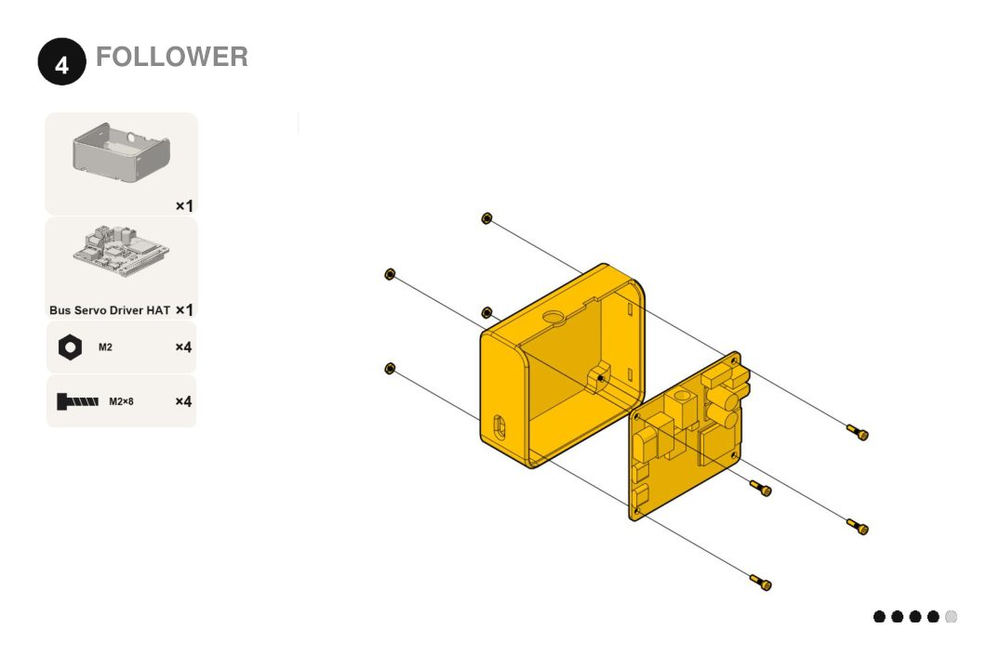
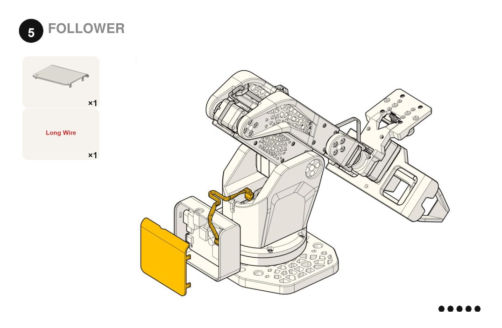
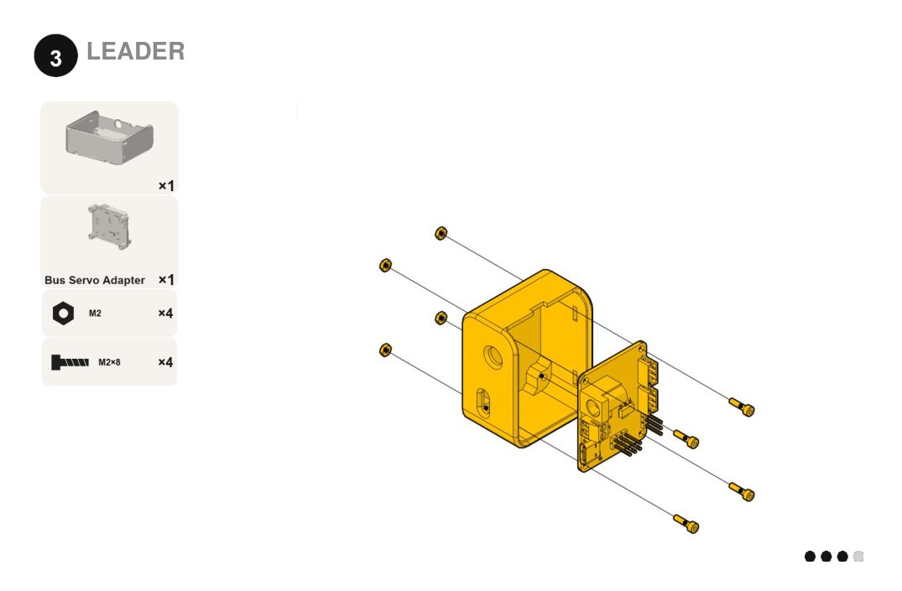
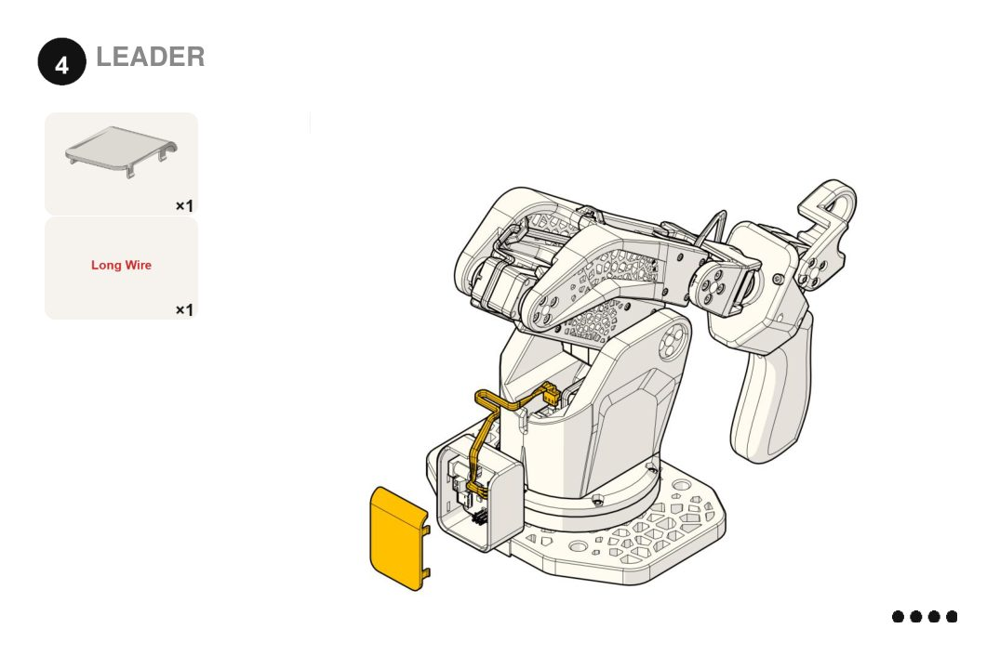

<!-- translation-navigation -->
[English](../../en/docs/assembly-guide.md) · [Русский](assembly-guide.md) · [Español](../../es/docs/assembly-guide.md) · [Français](../../fr/docs/assembly-guide.md) · [Deutsch](../../de/docs/assembly-guide.md) · [Português (Brasil)](../../pt-BR/docs/assembly-guide.md) · [简体中文](../../zh-CN/docs/assembly-guide.md) · [日本語](../../ja/docs/assembly-guide.md) · [हिन्दी](../../hi/docs/assembly-guide.md) · [العربية](../../ar/docs/assembly-guide.md)

[Английский оригинал](../../../assembly-guide.md)

[Документация](../README.md) · [Печать](printing.md) · [Комплектующие](bom.md) · [Сборка](assembly-guide.md) · [Характеристики](specifications.md) · [Модели](../models/README.md) · [Участие](../CONTRIBUTING.md) · [Лицензирование](../LICENSING.md) · [Переводы](translations.md)

> Полный перевод документа. Изображения и исходный PDF-буклет общие для всех языков. Перевод подготовлен с помощью ИИ; проверка носителями языка ещё не проведена.
<!-- /translation-navigation -->

<!-- translated-content -->

# Руководство по сборке

> Устаревшая инструкция: буклет и иллюстрации показывают прежнюю комплектацию с HAT. В BOM и руководстве по печати v0.2.0 используются Bus Servo Adapter на обеих руках, обновлённые детали захвата и другой крепёж. Старые шаги сборки захвата и контроллера не подходят для обновлённых деталей; новая инструкция ещё готовится.

Руководство следует буклету [SO-ARM102_assembly_A5_v0.6.pdf](../../../SO-ARM102_assembly_A5_v0.6.pdf) страница за страницей. Для бумажной версии распечатайте буклет в альбомной ориентации A5.

Перед началом:

- Напечатайте детали из [printing.md](printing.md) и подготовьте комплектующие по [bom.md](bom.md).
- Нужны шестигранники 1.5 mm (M2) и 2 mm (M3).
- Перед затяжкой читайте на два шага вперёд. В двух местах порядок сборки неудобен, см. [известные проблемы](../README.md#-known-issues).

> ⚠️ **Ведущая рука питается от 5 V, ведомая — от 12 V.** Не перепутайте блоки питания.

## Порядок работы

### Как читать иллюстрации

Бежевым выделены новые детали, серым — уже собранные. Миниатюра и количество показывают, что нужно добавить. Круг с номером обозначает шаг сборки, точки — прогресс. Номера деталей, размеры крепежа и ID сервоприводов одинаковы во всех языках.

### Последовательность сборки

1. Установите качалки на сервоприводы.
2. Соберите корпус руки **дважды**: для ведомой и для ведущей руки (шаги 1–11).
3. Соберите параллельный захват (шаги захвата 1–6).
4. Завершите ведомую руку: захват, камера, контроллер (шаги ведомой руки 1–5).
5. Завершите ведущую руку: рукоятка, курок, контроллер (шаги ведущей руки 1–4).

## Идентификаторы сервоприводов

Задайте ID каждого сервопривода до установки в руку. Инструменты настройки ID и калибровки: [lab.robonine.com](https://lab.robonine.com).

| ID | Сустав | Сервопривод ведомой руки | Сервопривод ведущей руки |
|:-:|---|---|---|
| 1 | Поворот основания | STS3235 | STS3215 |
| 2 | Подъём плеча | STS3250 | STS3215 |
| 3 | Сгибание локтя | STS3250 | STS3215 |
| 4 | Сгибание запястья | STS3235 | STS3215 |
| 5 | Вращение запястья | STS3215 | STS3215 |
| 6 | Захват / курок | STS3215 | STS3215 |

## 0. Качалки сервоприводов

На сервопривод ID 1 установите одну качалку винтом M3 × 6. На сервоприводы ID 2, 3 и 4 установите качалки с обеих сторон. Винты входят в комплект сервоприводов.

Если используете уплотнительные кольца на ведущей руке, установите их между сервоприводом и качалкой сейчас. При неправильном порядке кольцо может застрять между корпусом и качалкой.

## 1–11. Корпус ведомой и ведущей рук

Повторите эти шаги для обеих рук.

| Шаг | Детали | Крепёж |
|:-:|---|---|
| 1 | SO102.02.060 Нижний держатель сервопривода, SO102.02.040 Верхняя пластина основания | 3 × M3×16, 3 × гайка M3 |
| 2 | — | 3 × M3×16, 3 × гайка M3 |
| 3 | Сервопривод ID 1 | 4 × M2×6 |
| 4 | SO102.02.020 Кольцо основания, подшипник 6812, SO102.02.050 Нижнее кольцо, SO102.02.010 Основание | 6 × M3×16, 6 × гайка M3 |
| 5 | SO102.02.030 Шайба основания | 4 × M3×10, 6 × M3×16 |
| 6 | Сервоприводы ID 2 и ID 3, 2 × SO102.02.070 Нижнее звено, 2 коротких кабеля, 1 длинный кабель | 16 × M2×6 |
| 7 | Сервопривод ID 4, SO102.02.080-01 Верхнее звено правое, 1 короткий кабель | 4 × M2×6 |
| 8 | SO102.02.080 Верхнее звено левое, 2 × SO102.02.130 Клипса кабеля | 4 × M2×6, 8 × M3×10 |
| 9 | Сервопривод ID 5, SO102.02.090 Держатель запястья, качалка | 1 × M3×6, 4 × саморез 2×6 |
| 10 | 1 короткий кабель | 8 × M3×10 |
| 11 | — | 8 × M3×10 |

| | | |
|:-:|:-:|:-:|
|  |  |  |
|  |  |  |
|  |  |  |
|  |  |  |

Перед закрытием сустава проверьте, что кабель сервопривода достигает следующего сустава с небольшим запасом.

## Захват 1–6, только ведомая рука

| Шаг | Детали | Крепёж |
|:-:|---|---|
| 1 | RB9.01.062.040 Шестерня захвата на качалке, сервопривод ID 6 | 4 × установочный винт M3×4, 1 × M3×6 |
| 2 | 2 × RB9.01.062.024 Губка, 2 × RB9.01.062.030 Зубчатая рейка, 2 × RB9.01.062.100 Штифт | — |
| 3 | 2 × направляющая Ø6 × 125 mm | — |
| 4 | RB9.01.062.011 Основная рама, 2 × подшипник MF106ZZ | 2 × M4×8 |
| 5 | Защёлкните направляющие в основной раме | — |
| 6 | Раздвиньте губки до внешних упоров и установите сервопривод | 3 × саморез 2×6 |

Затягивайте установочные винты со стороны качалки к шестерне, чтобы между ними не появился зазор. Перед шагом 6 установите сервопривод ID 6 в минимальное положение: тогда захват будет полностью закрываться и раскрываться на 85 mm. До окончательной сборки вручную подвигайте обе губки по направляющим: они должны двигаться свободно, без заедания.

| | | |
|:-:|:-:|:-:|
|  |  |  |
|  |  |  |

## Ведомая рука 1–5

| Шаг | Детали | Крепёж |
|:-:|---|---|
| 1 | RB9.01.062.075 Держатель камеры | 4 × M3×10 |
| 2 | Установите захват в сборе на запястье | 4 × саморез 2×6 |
| 3 | RB9.01.062.090 Проставка камеры, USB-камера | 4 × M2×8, 4 × гайка M2 |
| 4 | SO102.02.100 Держатель платы ведомой руки, Waveshare Bus Servo Driver HAT | 4 × M2×8, 4 × гайка M2 |
| 5 | SO102.02.100-01 Крышка платы ведомой руки, длинный кабель | — |

| | | |
|:-:|:-:|:-:|
|  |  |  |
|  |  |  |

## Ведущая рука 1–4

| Шаг | Детали | Крепёж |
|:-:|---|---|
| 1 | Рукоятка SO102, узел вращения запястья SO102 | 4 × M3×6, 1 × саморез 2×6 |
| 2 | Курок SO102, сервопривод ID 6 | 4 × M3×6, 4 × саморез 2×6 |
| 3 | SO102.02.110 Держатель платы ведущей руки, Waveshare Bus Servo Adapter | 4 × M2×8, 4 × гайка M2 |
| 4 | SO102.02.110-01 Крышка платы ведущей руки, длинный кабель | — |

| | |
|:-:|:-:|
|  |  |
|  |  |

## Крепление и первый запуск

1. Закрепите каждое основание на столе двумя струбцинами.
2. Подключите контроллер ведомой руки к питанию 12 V, а контроллер ведущей — к 5 V.
3. Подключите оба контроллера к компьютеру через USB-C.
4. Откалибруйте обе руки и запустите телеуправление на [lab.robonine.com](https://lab.robonine.com) или по процессу настройки LeRobot SO-101.
<!-- /translated-content -->
