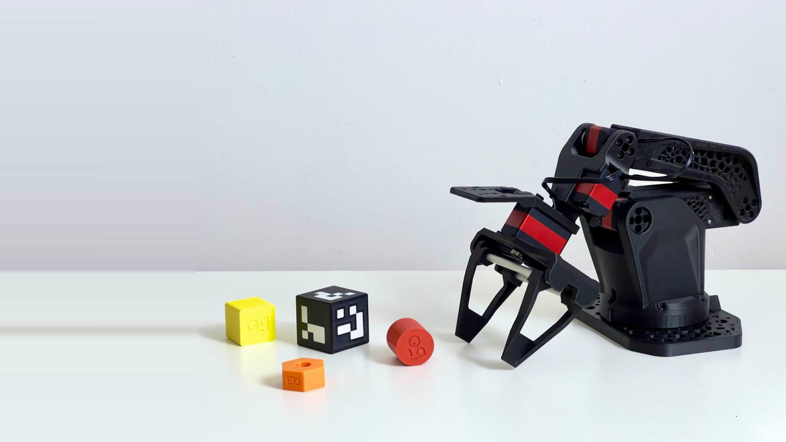
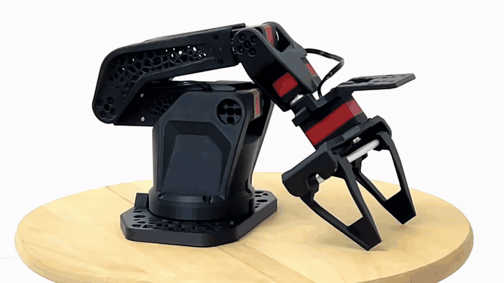
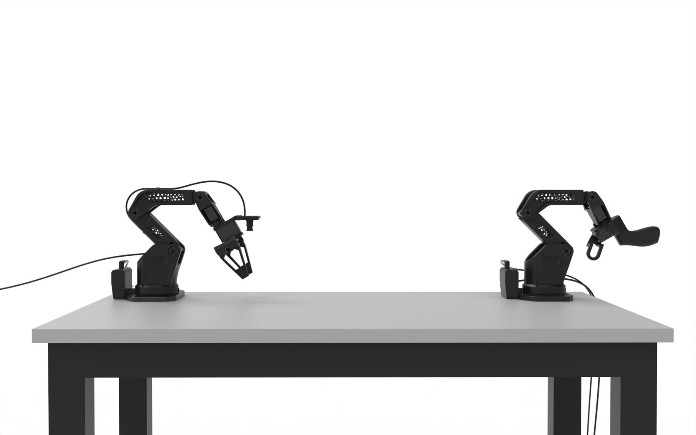
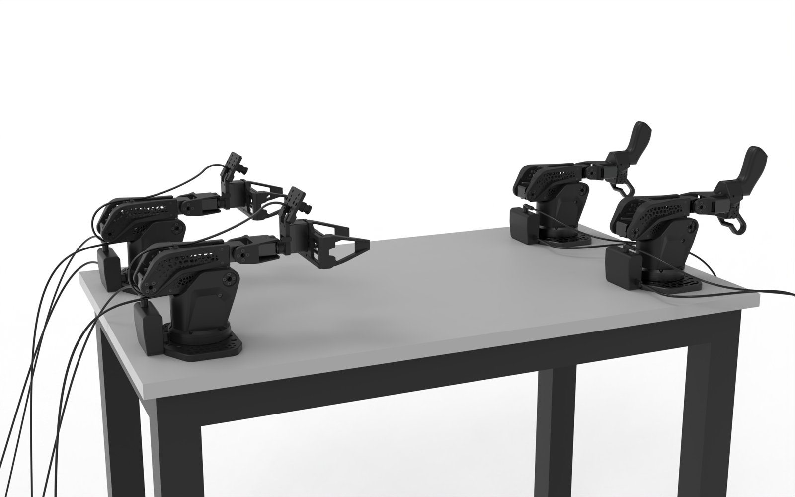
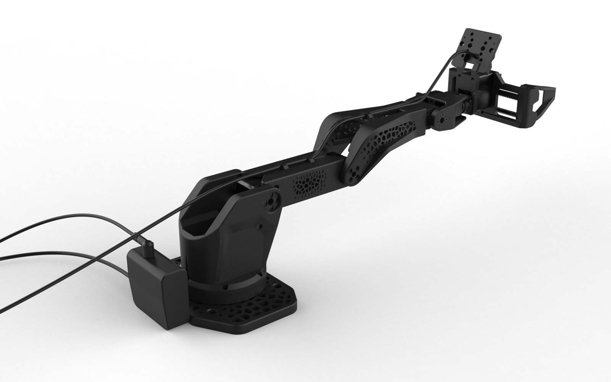
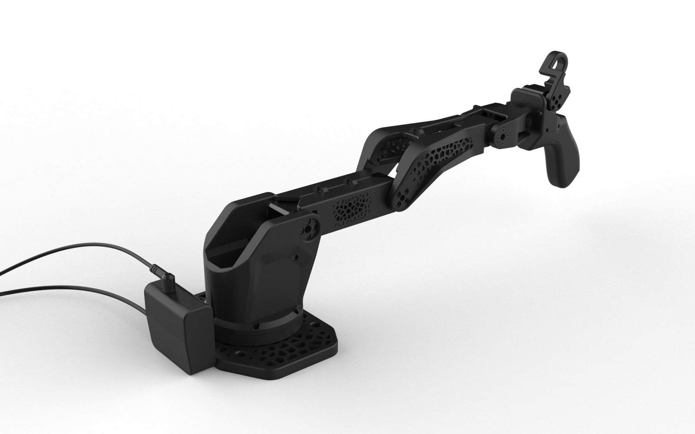

<!-- translation-navigation -->
[English](../en/README.md) · [Русский](../ru/README.md) · [Español](../es/README.md) · [Français](../fr/README.md) · [Deutsch](../de/README.md) · [Português (Brasil)](../pt-BR/README.md) · [简体中文](README.md) · [日本語](../ja/README.md) · [हिन्दी](../hi/README.md) · [العربية](../ar/README.md)

[英文原文](../../../README.md)

[文档](README.md) · [打印](docs/printing.md) · [物料清单](docs/bom.md) · [装配](docs/assembly-guide.md) · [规格](docs/specifications.md) · [模型](models/README.md) · [参与贡献](CONTRIBUTING.md) · [许可说明](LICENSING.md) · [翻译](docs/translations.md)

> 本文为完整译文。各语言共用插图和原始 PDF 手册。翻译由人工智能辅助完成，尚未经母语使用者审校。
<!-- /translation-navigation -->

<!-- translated-content -->
<a id="so-arm-102"></a>
# SO-ARM 102

<div align="center">

[](../../../assets/video/so-arm-102-preview.mp4)

**🎥 [观看预览视频 ](../../../assets/video/so-arm-102-preview.mp4)**·**🛒 [购买套装 ](https://robonine.com/shop/so-arm102-robotic-arm-kit/)**

SO-ARM 102 (SO-ARM102, SO-102) 是一套开源主从机械臂套件，具有 5 个自由度和一个夹爪，专为遥操作和模仿学习设计。

作为 SO-ARM 100 (SO-ARM100, SO-100) 和 SO-ARM 101 (SO-ARM101, SO-101) 机械臂的演进版本，它保留了 SO-ARM 101 的关节布局，以兼容 LeRobot 数据集和策略，同时提供更高的刚性、PET-CF 框架和平行夹爪。

[](../../../HARDWARE-LICENSE.txt) [](../../../SOFTWARE-LICENSE.txt) [](../../../DOCS-LICENSE.txt) [](https://github.com/roboninecom/SO-ARM-102/releases/latest)

📩 [hello@robonine.com](mailto:hello@robonine.com)

**DIY预算: ~$340 用于组件,或 ~$374 包括印刷材料。** [BOM摘要](#bill-of-materials) · [项目成本和购买链接 ](docs/bom.md#estimated-kit-cost)

> 不想自己采购零件和打印？**[购买 SO-ARM 102 套件](https://robonine.com/shop/so-arm102-robotic-arm-kit/)**。

</div>

---

<a id="-what-changed-against-so-arm-101"></a>
## ✨ 对比SO-ARM 101的变化

|  | SO-ARM 101 | SO-ARM 102 |
|---|---|---|
| 夹爪 | 角式夹爪 | 平行夹持器, 85 mm 跨度 |
| 框架材料 | PLA | PET-CF(已测试Fiberon PET-CF17) |
| 结构 | 实心连杆 | 拓扑优化连杆 |
| 底座旋转范围 | 220° | **352°** |
| 水平臂展 | 441 mm | **483 mm** |
| 夹持器的偏转,负载 300 g ¹ | 7.5 mm | **3.4–3.9 mm** |
| 肩部和肘部速度 | 45 RPM (STS3215) | **75 RPM (STS3250)** |
| 1 米处的噪音 | 70 dB | **60 dB** |

¹ 两个机器人手臂均采用印刷伺服电机模型制作,因此对比的是框架而不是电机。 完整的结果和测试条件见[docs/specifications.md ](docs/specifications.md)

机器人手臂保留 SO-ARM 101 关节布局,因此它使用 [Hugging Face LeRobot ](https://github.com/huggingface/lerobot) 数据集和策略。

---

<a id="-preview"></a>
## 预览

<div align="center">

[](../../../assets/video/so-arm-102-preview.mp4)

*点击查看完整视频, 21 s *

</div>

---

<a id="-configurations"></a>
## 🤝 配置

<a id="single-arm-one-leader--one-follower"></a>
### 单臂配置：一个主臂和一个从臂

标准套件。手动移动主臂，从臂会跟随其动作。用于遥操作和录制模仿学习示范。



<a id="bimanual-two-leaders--two-followers"></a>
### 双臂配置：两个主臂和两个从臂

两套套件并排放置，每只手分别操作一个主臂，因此从臂可以传递物体、夹持并操作零件，或完成其他需要双手协作的任务。



<a id="the-two-arms"></a>
### 两个机器人臂

| 从臂 | 主臂 |
|:-:|:-:|
|  |  |
| 平行夹持器,腕部摄像头,12 V | 带触发器的手柄, 5 V |

---

<a id="-build-it-in-four-steps"></a>
## 🚀 在四个步骤中构建它

想直接购买套件？**[购买 SO-ARM 102 套件](https://robonine.com/shop/so-arm102-robotic-arm-kit/)**。

<a id="1-print-the-parts"></a>
### 1. 打印零件

单个零件适合 180 × 180 mm 3D 打印机构造板,最大的部件长度为 160 mm。 所提供的 3MF 板布局使用 256 × 256 mm 3D 打印机构造板。

- 3MF 切片机项目,带有保存的方向和支撑设置:[`models/3mf/` ](../../../models/3mf) — [领导机器人臂 ](../../../models/3mf/SO102_leader.3mf) , [跟随机器人臂 ](../../../models/3mf/SO102_follower_arms.3mf) , [从动臂夹爪与底座](../../../models/3mf/SO102_follower_gripper_base.3mf)
- 项目内容和打印机配置文件: [models/README.md ](models/README.md)
- STL文件,准备切片:[`models/stl/` ](../../../models/stl)
- STEP来源：[`models/step/`](../../../models/step)
- 材料、设置和零件数量: [docs/printing.md ](docs/printing.md)


<a id="2-buy-the-hardware"></a>
### 2 。 购买硬件

从[BOM摘要 ](#bill-of-materials)和[带有购买链接的完整 BOM ](docs/bom.md)中获取组件。 预算 **$340.22**用于组件,或**$373.97** 包括印刷材料,运费和税前。

| 机械臂 | 舵机 | 控制器 | 电源 |
|---|---|---|---|
| 从臂 | 2 × STS3235, 2 × STS3250, 2 × STS3215 | Waveshare Bus Servo Adapter | **12 V** |
| 主臂 | 6 × STS3215 | Waveshare Bus Servo Adapter | **5 V** |

> ⚠️ **主臂使用 5 V 电源，从臂使用 12 V 电源。** 切勿互换电源。

<a id="3-assemble"></a>
### 3. 组装

- 可打印的小册子，32页 A5：[docs/SO-ARM102_assembly_A5_v0.7.pdf](../../SO-ARM102_assembly_A5_v0.7.pdf)
- 带有零件和紧固件的步骤列表: [docs/assembly-guide.md ](docs/assembly-guide.md)

工具:六角钥匙 1.5 mm (M2螺丝) 和 2 mm (M3螺丝) 。

<a id="4-set-up-the-software"></a>
### 4 。 设置软件

伺服 ID、校准和教程: **[ lab.robonine.com ](https://lab.robonine.com)**.
使用 SO-ARM 102 从动臂插件和标准类型 `so101_leader`。
**[LeRobot 安装与配置](docs/lerobot.md)**.

---

<a id="bill-of-materials"></a>
## 物料清单

**一个主臂和一个从臂**所需的数量及参考成本：

| 类别/购买链接 | 套件内容 | 总计 (USD) |
|---|---|---:|
| [舵机](docs/bom.md#servos) | 6 × STS3215 7.4 V, 2 × STS3215 12 V, 2 × STS3235, 2 × STS3250 | $240.72 |
| [电子元件](docs/bom.md#electronics) | 2 控制器, 2 电源, 2 USB 线缆, 1 手腕摄像头 | $50.50 |
| [机械零件](docs/bom.md#mechanical-parts) | 4 轴承, 2 钢制导轨, 4 工作台夹具 | $37.76 |
| [紧固件](docs/bom.md#fasteners) | 螺丝和螺母;包括指定的伺服电机套件螺丝 | $11.24 |
| **零部件小计** |  | **$340.22** |
| [印刷材料 ](docs/bom.md#printing-materials) | 0.4 kg PET-CF17 + 0.75 kg PETG 补贴 | $33.75 |
| **含打印材料总计** |  | **$373.97** |

从头开始购买完整包装和丝线卷轴的成本约为 **$435**,包括未使用的备件。 这些是参考估计数,不是新供应商报价,不包括运费、税费、工具、电脑、打印机、电力和组装劳动力。 在订购之前请确认供应商价格、变体和最小订单量;使用3D打印切片器再次切割 3MF 项目以检查纤维消耗。

[完整的物料清单、购买链接和成本假设 ](docs/bom.md#estimated-kit-cost) 。

---

<a id="urdf-export"></a>
## URDF 出口

当前的独立导出位于 [`simulation/urdf/`](../../../simulation/urdf) : [ URDF ](../../../simulation/urdf/so_arm_102.urdf) · [ Xacro ](../../../simulation/urdf/so_arm_102.xacro) 。 在描述文件旁边保留 `meshes/`；网格路径相对于此文件夹。

- **视觉效果:** STL 网格。** 碰撞:** 在所有八个链条上安装了独立旋转的框架。
- **质量估计:** PLA , 30 % 填充率, 6 周长, 6 顶部/底部层, 0.2 mm 层高度和 **0.40 mm 挤出宽度** 。 这些是模拟假设;使用[打印指南 ](docs/printing.md)进行制造设置。
- **硬件重量:** 六个电机,每个在 70 g;基座轴承在 105 g。 估计的模型总重量: ** 0.889 kg * 。
- **抓取器 : ** `clamp2` 模拟 `clamp1` 并具有乘数 `-1`。

[导出设置 ](../../../simulation/urdf/export_settings.json)和[质量属性 ](../../../simulation/urdf/mass_properties.json)记录假设。 几何形状和惯性检查记录在 [export_verification.json](../../../simulation/urdf/export_verification.json).

---

<a id="-repository-structure"></a>
## 储存库结构

```
├── models/
│   ├── 3mf/                 # 切片机项目:领导者机器人臂,跟随者机器人臂,抓具和板箱
│   ├── stl/                 # 打印準備網格
│   │   ├── common/          # 共用零件，包括控制器外壳
│   │   ├── follower/        # 平行夹爪和相机支架
│   │   └── leader/          # 手柄、扳机和腕部旋转件
│   └── step/                # CAD 源代码,与 stl / 相同的布局
├── docs/
│   ├── printing.md          # 材料、切片机设置、数量
│   ├── bom.md               # 物料清单
│   ├── assembly-guide.md    # 带有零件和紧固件的步骤列表
│   ├── specifications.md    # 几何形状、伺服电机、测量结果 vs SO-ARM 101
│   └── SO-ARM102_assembly_A5_v0.7.pdf
├── assets/
│   ├── images/              # 照片,渲染,小册子页面,测试照片
│   └── video/               # 预览视频和GIF
├── LICENSING.md             # 哪个许可证涵盖哪个文件
└── NOTICE                   # 第三方归属
```

---

<a id="-known-issues"></a>
## 已知问题

以下是独立测试装配中的注意事项，组装时请检查。

1. **请使用 v0.7 手册。** 旧版手册展示 HAT 控制器和旧版夹爪零件。v0.7 为两只机械臂均安装 Bus Servo Adapter。
2. **M2 螺丝在几个地方很难触及。** 预计会与其中一些人战斗。
3. **夹持器夹具在碳棒上运行时紧固。** 夹持孔尺寸为 6.1 mm。 杆直径因供应商而异,因此在装配前检查适合性。
4. ** 在关闭每个接头之前检查伺服电机的电缆长度,特别是从底座到肩部。
5. ** 装配顺序在小册子的两个地方有些不对劲。 在固定前请提前阅读两步。
6. **主臂关节可能感觉偏松。** 在每个舵机与舵盘之间加入 8 × 2 mm 橡胶 O 形圈，可使主臂产生平滑、安静的摩擦。关节 1–4 每个舵机使用两个，关节 5–6 每个使用一个。

您还找到其他东西吗? 请 [打开问题 ](https://github.com/roboninecom/SO-ARM-102/issues) 。

---

<a id="-star-history"></a>
## ⭐ 星标历史

[](https://www.star-history.com/?repos=roboninecom%2Fso-arm-102&type=date&legend=top-left)

---

<a id="-related-projects"></a>
## 相关项目

- [SO-ARM100/101 Parallel Gripper ](https://github.com/roboninecom/SO-ARM100-101-Parallel-Gripper) , 抓具 SO-ARM 102 抓具从中增长
- [SO-ARM101 ](https://github.com/TheRobotStudio/SO-ARM100)通过TheRobotStudio,机器人手臂本设计成功
- [智能串行伺服电机的实际比较 ](https://robonine.com/smart-serial-servo-motor-comparison-robotics/) , 选择伺服电机背后的测试
- [选择机器人手臂的纤维 ](https://robonine.com/choosing-filament-for-robotic-arm-applications/) , PET-CF背后的测试

---

<a id="-license"></a>
## 📄许可证

Copyright (c ) 2026 Robonine . 不同类型的材料有不同的许可证:

| 材料 | 许可证 |
|---|---|
| `models/` 的硬件设计 | [CERN-OHL-P-2.0](../../../HARDWARE-LICENSE.txt) |
| 软件和配置 | [Apache-2.0](../../../SOFTWARE-LICENSE.txt) |
| `docs/`, `assets/`, 所有 `README.md` 中的文档和图片 | [CC BY 4.0](../../../DOCS-LICENSE.txt) |

请参见 [LICENSING.md](LICENSING.md) 和 [REUSE.toml ](../../../REUSE.toml) 来获取逐个文件的映射。

---

<a id="-team"></a>
## 👥队伍

| 名称 | 职责 | 联系方式 |
|------|------|---------|
| **Alan Subin** | 设计工程师:机械设计, CAD,装配手册 | [LinkedIn](https://www.linkedin.com/in/alan-subin/) |
| **Boris Kotov** | 软件和测试工程师:原型,打印,测试台 | [Telegram](https://t.me/bkotov) |
| **Nikita Bragin** | 项目经理 | [LinkedIn](https://www.linkedin.com/in/nikita-bragin-82296b29/) |
| **Mikhail Chistiakov** | 工业设计师:外观和形式的机器人臂 | [Telegram](https://t.me/brrryska) |
| **Mikhail Zhmaylo** | 结构工程师:刚度模型,设计变更以减少偏差 | [Telegram](https://t.me/mikhail_zhmaylo) |
| **Vladislav Eremenko** | 结构工程师:强度和热分析,拓扑优化 | [Telegram](https://t.me/v1ad_eremenko) |
| **Vladimir Osipov** | 测试员和顾问:独立测试构建 | [LinkedIn](https://www.linkedin.com/in/vladimirosipov/) |

<div align="center">

**由 [Robonine](https://robonine.com)** 为机器人社区打造

</div>
<!-- /translated-content -->
