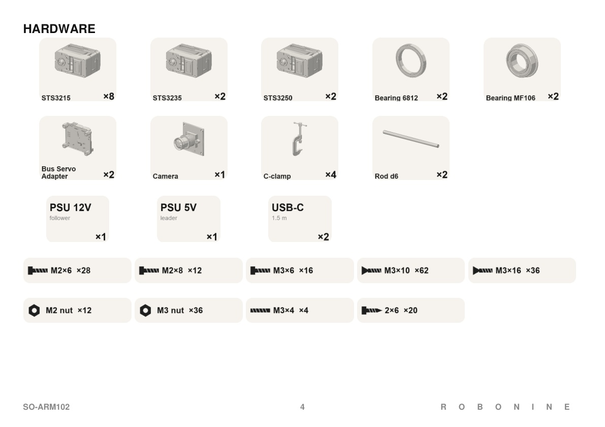

<!-- translation-navigation -->
[English](../../en/docs/bom.md) · [Русский](../../ru/docs/bom.md) · [Español](../../es/docs/bom.md) · [Français](../../fr/docs/bom.md) · [Deutsch](../../de/docs/bom.md) · [Português (Brasil)](../../pt-BR/docs/bom.md) · [简体中文](bom.md) · [日本語](../../ja/docs/bom.md) · [हिन्दी](../../hi/docs/bom.md) · [العربية](../../ar/docs/bom.md)

[英文原文](../../../bom.md)

[文档](../README.md) · [打印](printing.md) · [物料清单](bom.md) · [装配](assembly-guide.md) · [规格](specifications.md) · [模型](../models/README.md) · [参与贡献](../CONTRIBUTING.md) · [许可说明](../LICENSING.md) · [翻译](translations.md)

> 本文为完整译文。各语言共用插图和原始 PDF 手册。翻译由人工智能辅助完成，尚未经母语使用者审校。
<!-- /translation-navigation -->

<!-- translated-content -->

# 物料清单

数量为一个完整的套件:一个跟随机器人臂和一个领导机器人臂。 打印部件在[printing.md ](printing.md)中单独列出。

## 估计费用

> 以下费用保留此前采用钢制导杆的估算。铝制导向管需要重新报价；这些总额并非铝制方案套件的已确认价格。

** 一个领导机器人臂 + 一个跟踪机器人臂: $340 组件,或 $374 包括印刷材料。

| 类别 | 使用数量的成本(美元) | 购买完整包装/卷轴 (USD) |
|---|---:|---:|
| 服务器(12 pcs) | $240.72 | $240.72 |
| 电子、摄像头和电源 | $50.50 | $50.50 |
| 轴承、钢制导杆和工作台夹具 | $37.76 | $49.70 |
| 紧固件 | $11.24 | $28.60 |
| **零部件小计** | **$340.22** | **$368.82** |
| 印刷材料：0.4 kg PET-CF17 + 0.75 kg PETG | $33.75 | $66.0 |
| **含打印材料总计** | **$373.97** | **$434.82** |

**总计 (美元)** 栏是一个套件所需数量的成本,使用每个现有行总额后面的参考报价(而不是供应商报价的总和 ) 。 包括螺丝的价格为 $0;替代碳纤维管不包括在总数中。 估算使用下列参考价格,每行四舍五入到最小值。 它们不是新供应商报价:确认选择的变体、最低订单数量和价格,然后再订购。 不包括运费、税费、工具、电脑、打印机、电力和装配工人。

完整包装的柱子包括未使用的备件,0.5 kg PET-CF17 卷轴和 1 kg PETG 卷轴。 打印数量是预算允许值;使用 3D 打印切片机再次切割所提供的 3MF 项目以适应您的设置。

## 舵机

| 关节 | ID | 从臂 | 主臂 |
|---|:-:|---|---|
| 底座旋转 | 1 | ST-3235-С001 | ST-3215-C066, 1:191 |
| 肩部抬升 | 2 | ST-3250-С002 | ST-3215-C066, 1:191 |
| 肘部屈伸 | 3 | ST-3250-С002 | ST-3215-C066, 1:191 |
| 腕部屈伸 | 4 | ST-3235-С001 | ST-3215-C066, 1:191 |
| 腕部旋转 | 5 | ST-3215-C049, 1:191 | ST-3215-C066, 1:191 |
| 夹爪 / 扳机 | 6 | ST-3215-C049, 1:191 | ST-3215-C066, 1:191 |

总计: 6 × STS3215 7.4V, 2 × STS3215 12V, 2 × STS3235 12V, 2 × STS3250 12V. 所有都是Feetech TTL串行总线伺服电机。

| 舵机 | 数量 | 型号选择 | Aliexpress 链接 | 单价 (USD) | Alibaba 链接 | 单价 (USD) | 总计 (USD) |
|---|---|---|---|---|---|---|---|
| STS3215 | 6 | 7.4V TTL 版本用于领导机器人臂伺服电机。 选择 ST-3215-C066 (7.4V) 。 | [Aliexpress](https://www.aliexpress.us/item/3256811860804361.html) | $32.8 | [Alibaba](https://www.alibaba.com/product-detail/Feetech-SO-ARM101-LeRobot-Open-Source_1601636174153.html) | $6.74 | $40.44 |
| STS3215 | 2 | 12V TTL 版本适用于跟踪机器人臂关节 5 和 6。 选择 ST-3215-C049 (12V30KG) 。 | [Aliexpress](https://www.aliexpress.us/item/3256811832699316.html) | 2pcs的$55.8 | [Alibaba](https://www.alibaba.com/product-detail/6pcs-12V-30KG-1-345-STS3215_1601900233170.html) | $14.70 | $29.40 |
| STS3235 | 2 | 12V TTL 版本适用于跟踪机器人臂关节 1 和 4。 | [Aliexpress](https://www.aliexpress.us/item/3256810213842277.html) | $63 | [Alibaba](https://www.alibaba.com/product-detail/FEETECH-STS3235-12V-30KG-TTL-Dual_1601910640629.html) | $40.79 | $81.58 |
| STS3250 | 2 | 12V TTL 版本适用于跟踪机器人臂关节 2 和 3。 | [Aliexpress](https://www.aliexpress.us/item/3256811995148799.html) | 2pcs的$126.4 | [Alibaba](https://www.alibaba.com/product-detail/Feetech-STS3250-12V-50kg-Servo-High_1601711893549.html) | $44.65 | $89.30 |
| **总计** |  |  |  |  |  |  | **$240.72** |

- **跟随机器人手臂,12V。** STS3250是位于75 RPM的50 kg·cm无刷伺服电机,它驱动两个承载最大负荷的关节。 STS3235是比STS3215空隙更小的30 kg·cm伺服电机。
- **领导机器人臂,5V。** 领导机器人臂的伺服电机只读取,不会加载。 您可以使用无电机和齿轮箱的被动 ST-3215-C066 ** 仅适用于领导机器人臂。
- 伺服电机配有伺服喇叭和 M3 × 6 喇叭螺杆。

## 电子元件

| 项目 | 数量 | 备注 | 美国采购 | 单价（美国） | 美国采购 | 单价（美国） | 欧盟采购 | 单价（欧盟） | 总计 (USD) |
| --- | --- | --- | --- | --- | --- | --- | --- | --- | --- |
| Waveshare Bus Servo Adapter | 2 | 舵机控制器 | [Amazon](https://www.amazon.com/Waveshare-Integrates-Control-Applicable-Integrate/dp/B0CJ6TP3TP/) | $13.00 | [Aliexpress](https://www.aliexpress.us/item/3256810343532716.html) | $7.40 | [Amazon EU](https://www.amazon.fr/-/en/Serial-Integrates-Control-Circuit-Support/dp/B0CJBKQ8LJ/) | €11.90 | $14.80 |
| 电源 12V DC (12V 5A 电源 5.5 2.1mm) | 1 | 从臂。建议使用 60W / 5A 或更高额定电流的电源。机械臂在 300g 负载下的峰值电流为 3.3A。请匹配 Adapter 的接口尺寸（5.5x2.1mm）。 | [Amazon](https://www.amazon.com/Power-Supply-Adapter-5-5x2-1-2-5mm/dp/B0C3CJF313/) | $10.00 | [Aliexpress](https://www.aliexpress.us/item/3256812113231032.html) | $6.60 | [Amazon EU](https://www.amazon.fr/-/en/zstg-Universal-Power-Supply-Connector/dp/B0GTLSRM91/) | €12.00 | $6.60 |
| 电源 5V DC (5V 2A 电源 5.5 2.1mm) | 1 | 主臂。请匹配适配器的接口尺寸（5.5x2.1mm）。 | [Amazon](https://www.amazon.com/MTDZKJG-Adapter-100V-240V-Transformer-Security/dp/B0BZP65GRW/) | $6.20 | [Aliexpress](https://www.aliexpress.us/item/3256812479558626.html) | $4.10 | [Amazon EU](https://www.amazon.fr/5V-2A-Supply-DC-Adapter/dp/B0GDXFRYJS/) | €11.00 | $4.10 |
| USB-C 电缆,1.5 m(USB A 到 USB C 数据线 1.5m) | 2 | 每个控制器一根。 选择数据线,而不是只用于充电的线缆。 | [Amazon](https://www.amazon.com/Data-Cable-1-5ft-10Gbps-Transfer/dp/B0FMJTHRCM/) | $6.00 | [Aliexpress](https://www.aliexpress.us/item/3256812299430938.html) | $3.00 | [Amazon EU](https://www.amazon.fr/-/en/10Gbps-Transfer-Charging-Samsung-External/dp/B0DHZ1R8FQ/) | €7.00 | $6.00 |
| USB摄像头(OV2735, 1080P USB摄像头模块,2MP 1920x1080,UVC摄像头,2.8或3.0 mm镜头) | 1 | 跟踪机器人臂抓具上的腕部摄像头。 原型采用 OV2735 模块,检查相机支架的模块尺寸和安装孔。 | [Amazon](https://www.amazon.com/innomaker-Computer-Raspberry-Support-Windows/dp/B0CNCSFQC1/) | $19.00 | [Aliexpress](https://www.aliexpress.us/item/3256804452094739.html) | $26.10 | [Amazon EU](https://www.amazon.fr/InnoMaker-Raspberry-Compatible-Windows-Android/dp/B0CNCSFQC1/) | €21.00 | $19.00 |
| **总计** |  |  |  |  |  |  |  |  | **$50.50** |

## 机械零件

| 项目 | 尺寸 | 数量 | 位置 | 美国采购 | 单价（美国） | 美国采购 | 单价（美国） | 欧盟采购 | 单价（欧盟） | 总计 (USD) |
| --- | --- | --- | --- | --- | --- | --- | --- | --- | --- | --- |
| 球轴承 6812 | 60 × 78 × 10 mm | 2 | 基座旋转,每个机器人臂一个 | [Amazon](https://www.amazon.com/Othmro-6812-2RS-60x78x10mm-Accuracy-Bearing/dp/B081W9QL2Z/) | $5.90 | [Aliexpress](https://www.aliexpress.us/item/3256812369319030.html) | $39.60 / 2 | [Amazon EU](https://www.amazon.fr/-/en/XYWHPGV-6812-2RS-Groove-Bearings-Chrome/dp/B0CQLT6J6D/) | €7.40 / 2 | $11.80 |
| 法兰轴承 MF106ZZ | 6 × 10 × 3 mm | 2 | 夹爪主框架 | [Amazon](https://www.amazon.com/METERXITY-Shielded-Bearings-Wheelbarrow-Machines/dp/B0F4QXJSRQ/) | $6.60 / 4 | [Aliexpress](https://www.aliexpress.us/item/3256807821523719.html) | $6.00 / 10 | [Amazon EU](https://www.amazon.fr/-/en/PRECISCRY-DE-SGQ-FLZC-11-MF128ZZ-8x12x3-5-5Pcs/dp/B0GQK9BGWK/) | €11.60 / 5 | $1.20 |
| 铝制导向管 | Ø6 × 4 × 125 mm | 2 | 夹爪导向管 | — | 需询价 | — | 需询价 | — | 需询价 | — |
| 碳管（碳管，6mm x4mm x125mm），替代品 | Ø6 × 4 × 125 mm | 2 | 钢制夹具导向杆的替代品 | [Amazon](https://www.amazon.com/MECCANIXITY-Carbon-Pultruded-Airplane-Quadcopter/dp/B0CZDCW2NL/) | $5.60 / 2 | [Aliexpress](https://www.aliexpress.us/item/3256812851232051.html) | $5.90 / 2 | [Amazon EU](https://www.amazon.fr/-/en/QUARKZMAN-Carbon-Fiber-Tubes-Aircraft/dp/B0CZQVN7JB/) | €8.10 / 2 | $5.60(备选) |
| C型夹具 | 3英寸，0-75 mm开口 | 4 | 每个机器人手臂两个,用于将底座固定在桌子上 | [Amazon](https://www.amazon.com/Inch-Clamp-Woodworking-Precision-Carpentry/dp/B0FLHZVM7G/) | $10.00 / 2 | [Aliexpress](https://www.aliexpress.us/item/3256813098676278.html) | $9.70 | [Amazon EU](https://www.amazon.fr/Performance-75mm-Adjustable-Stainless-Metalworking/dp/B0GSQL9BCN/) | €17.40 / 2 | $20.00 |
| **总计** |  |  |  |  |  |  |  |  |  | **$37.76** |

## 紧固件

在装配手册中包装的套件总数。

使用与打印塑料兼容的可拆卸螺纹锁固剂，例如 [Vibra-Tite VC-3](https://www.vibra-tite.com/faq/if-vc-3-has-mek-how-can-it-be-plastic-compatible/)。将 VC-3 涂在金属螺钉的螺纹上，完全干燥后再组装（按[技术资料](https://www.vibra-tite.com/wp-content/uploads/213_tds.pdf)至少等待 30 分钟）；不要将未干的锁固剂涂在塑料上。先用同种耗材的试打印件验证兼容性。

| 紧固件 | 标准 | 数量 | 美国采购 | 单价（美国） | 美国采购 | 单价（美国） | 欧盟采购 | 单价（欧盟） | 总计 (USD) |
| --- | --- | --- | --- | --- | --- | --- | --- | --- | --- |
| M2 × 6 内六角圆柱头 | DIN 912 | 28 | [Amazon](https://www.amazon.com/Socket-Stainless-Threaded-Furniture-Printing/dp/B0DKY8XHB1/) | $6.60 / 60 | [Aliexpress](https://www.aliexpress.us/item/3256812583382995.html) | $3.70 / 100 | [Amazon EU](https://www.amazon.fr/-/en/THFJWJ-M2-Allen-Cylinder-Screws/dp/B0FP8ZP1XT/) | €6.60 / 60 | $1.04 |
| M2 × 8 内六角圆柱头 | DIN 912 | 12 | [Amazon](https://www.amazon.com/Socket-Stainless-Threaded-Furniture-Printing/dp/B0DKY7L8YJ/) | $6.60 / 50 | [Aliexpress](https://www.aliexpress.us/item/3256812583382995.html) | $4.10 / 100 | [Amazon EU](https://www.amazon.fr/-/en/THFJWJ-M2-Allen-Cylinder-Screws/dp/B0FP8ZKVDN/) | €7.00 / 60 | $0.49 |
| M3 × 10 沉头 | DIN 7991 | 62 | [Amazon](https://www.amazon.com/M3-0-5-Socket-Screws-Alloy-Threaded/dp/B08HNF3J3D/) | $9.00 / 100 | [Aliexpress](https://www.aliexpress.us/item/3256812583382995.html) | $3.70 / 50 | [Amazon EU](https://www.amazon.fr/-/en/Mbsomnus-Countersunk-Stainless-Mechanical-Furniture/dp/B0DY12R93P/) | €8.00 / 60 | $4.59 |
| M3 × 16 沉头 | DIN 7991 | 36 | [Amazon](https://www.amazon.com/Skweawert-40-Pcs-M3x16mm-countersunk/dp/B0D7MY32JZ/) | $6.20 / 40 | [Aliexpress](https://www.aliexpress.us/item/3256812583382995.html) | $4.10 / 50 | [Amazon EU](https://www.amazon.fr/-/en/Mbsomnus-Countersunk-Stainless-Mechanical-Furniture/dp/B0DY138MGY/) | €8.00 / 60 | $2.95 |
| M3 × 4 紧定螺钉 | DIN 913 | 4 | [Amazon](https://www.amazon.com/Generic-Bathroom-Fixtures-Furniture-Project/dp/B0H8DPZJPQ/) | $4.60 / 60 | [Aliexpress](https://www.aliexpress.us/item/3256805653005840.html) | $2.10 / 10 | [Amazon EU](https://www.amazon.fr/-/en/MIETONG-Hex-Socket-Grub-Screws/dp/B0FSKLJR93/) | €6.00 / 20 | $0.31 |
| M2 六角螺母 | DIN 934 | 12 | [Amazon](https://www.amazon.com/1-10Pcs-M1-M20-Stainless-Steel-Loose/dp/B0GVMQ3VD5/) | $3.50 / 100 | [Aliexpress](https://www.aliexpress.us/item/3256812621986317.html) | $4.10 / 100 | [Amazon EU](https://www.amazon.fr/-/en/PRORAJE-Stainless-Steel-Hexagonal-Diameter/dp/B0GVC5QKH9/) | €6.00 / 20 | $0.42 |
| M3 六角螺母 | DIN 934 | 36 | [Amazon](https://www.amazon.com/FOCMKEAS-Stainless-Hexagon-Fasteners-Hardware/dp/B0CR7WL4D6/) | $3.70 / 50 | [Aliexpress](https://www.aliexpress.us/item/3256812621986317.html) | $4.00 / 100 | [Amazon EU](https://www.amazon.fr/-/en/PRORAJE-Stainless-Steel-Hexagonal-Diameter/dp/B0GVC7PD4Q/) | €6.30 / 50 | $1.44 |
| M3 × 6 菲利普斯头螺丝 | 舵机附带 | 16 | 舵机附带。 | — | — | — | — | — | — |
| 自攻螺丝 2 × 6 | 舵机附带 | 20 | 舵机附带。 | — | — | — | — | — | — |
| **总计** |  |  |  |  |  |  |  |  | **$11.24** |

黑色紧固件与渲染图的外观相匹配,但并非必需。

## 打印材料

| 材料 | 用途 | 采购链接 | 价格 / 预算 (USD) | 总计 (USD) |
|---|---|---|---|---:|
| Fiberon PET-CF17 | 机械臂连杆和舵机支架 | [Polymaker](https://shop.polymaker.com/products/fiberon-pet-cf17) | $44.99 / 1 kg | $18.00 (0.4 kg) |
| PETG或PET-CF | 抓具夹,盖子,领导机器人臂手柄和触发器 | [Amazon](https://www.amazon.com/Bambu-Printer-Filament-1-75mm-Spool/dp/B0GS568LQ1/) | PETG: $21.00 / 1 kg | $15.75 (0.75 kg) |
| **总计** |  |  |  | **$33.75** |

使用[打印指南 ](printing.md)并使用3D打印切片器再次切割所提供的3MF项目,以确定您的打印机和设置的纤维数量。

## 工具

如果您没有这些工具,请留出约 **$10.00** 用于一套小型六角扳手和螺丝刀。

- 六角钥匙1.5 mm用于M2螺丝：[Amazon search](https://www.amazon.com/s?k=1.5mm+hex+key)
- 六角钥匙2 mm用于M3螺丝：[Amazon search](https://www.amazon.com/s?k=2mm+hex+key)
- Phillips PH1螺丝刀用于伺服电机角螺钉:[Amazon search ](https://www.amazon.com/s?k=PH1+Phillips+screwdriver)
<!-- /translated-content -->
